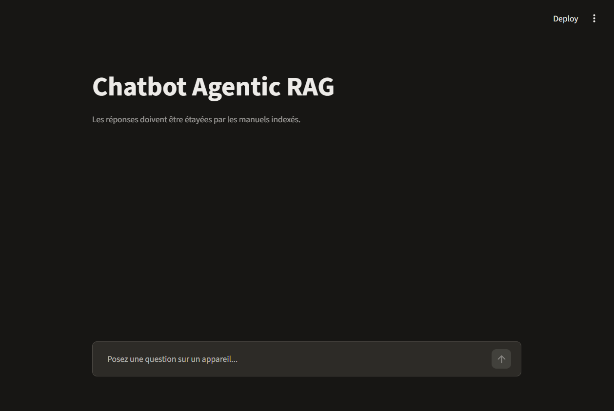
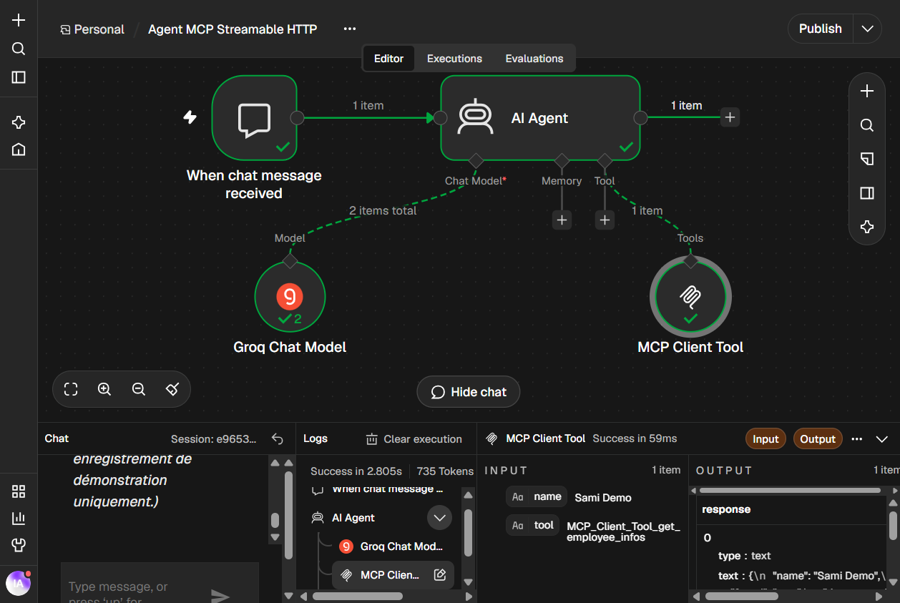
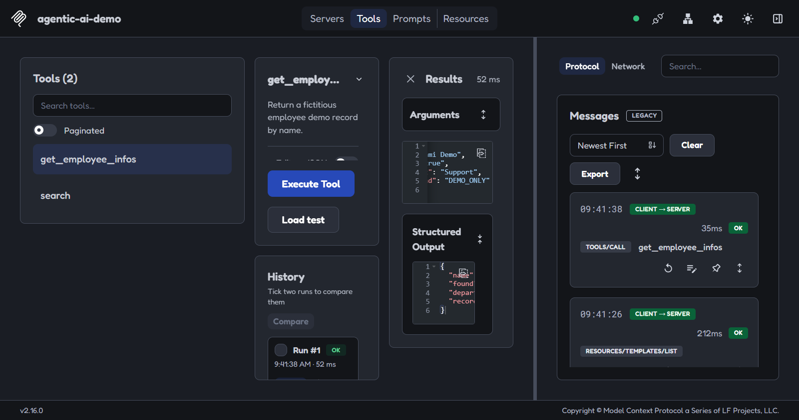
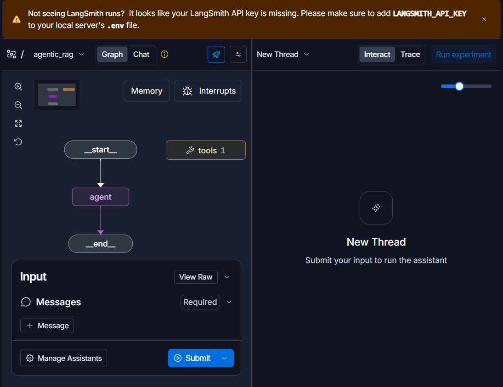
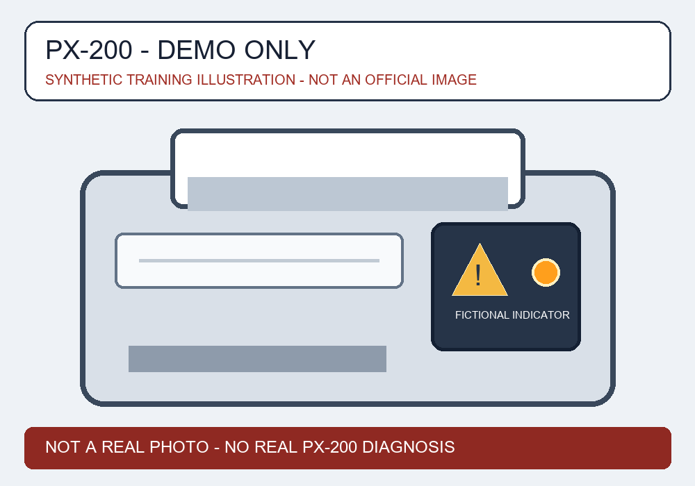

# TP Agentic AI : LangChain, LangGraph et MCP

## Installation

Depuis la racine du projet, avec Python 3.11 ou 3.12 :

```powershell
python -m venv .venv
.\.venv\Scripts\Activate.ps1
python -m pip install -r requirements.txt
Copy-Item .env.example .env
```

Renseigner `GROQ_API_KEY` dans `.env` pour les agents LLM. `TAVILY_API_KEY` est
nécessaire uniquement pour les recherches Tavily. Ne jamais partager ni ajouter
`.env` au dépôt.

## Répertoires

- `A_LangChain/` : agents, mémoire, outils et RAG LangChain.
- `B_LangGraph/` : graphes de base, RAG agentique et interface Streamlit.
- `C_MCP/` : serveur MCP de démonstration et client agent.
- `D_Projet_Final_SAV/` : orchestrateur SAV, outil de garantie local et serveur
  MCP documentaire.
- `data/manuals/corpus.example.json` : corpus pédagogique fictif avec une
  illustration synthétique, explicitement marqué `DEMO_ONLY` (pas une source
  constructeur).
- `data/demo_assets/img_px200_01_demo.png` : mockup synthétique, pas une photo
  réelle de l'imprimante.
- `data/warranty_registry.example.csv` : données fictives de démonstration,
  jamais à utiliser pour une vraie décision de garantie.

Le corpus d'exemple permet de tester le flux avec `img_px200_01`, mais sa
réponse est fictive et ne doit pas servir au dépannage réel. Pour un vrai
diagnostic, remplacer ces données par le manuel constructeur et la photo
authentique. `data/manuals/corpus.json` est ignoré par Git pour éviter de
partager des documents internes. Le serveur RAG retourne les sources
correspondantes ; il ne fabrique pas une réponse quand aucune source n'est
trouvée.

## Lancement

Les instructions propres à chaque partie sont dans les `README.md` de leurs
répertoires. Vérification locale :

```powershell
python -m pytest
```

Les tests Python ne remplacent pas la validation visuelle dans LangGraph
Studio. Le stack Compose démarre n8n, MCP Inspector et le serveur MCP de démo
sur loopback. Le workflow n8n est fourni et importé, mais nécessite une
credential Groq configurée dans n8n avant son exécution. Voir
[C_MCP/n8n_setup.md](C_MCP/n8n_setup.md).

## Rapport du projet

### Objectif

Ce TP met en pratique les agents LangChain, les graphes LangGraph, le protocole
MCP et un scénario de service après-vente orchestré par LangGraph.

### Réalisations

- **A — LangChain :** exemples d'agent, mémoire, outils, sélection dynamique du
  modèle, prompt dynamique, gestion d'erreur d'outil, garde-fous et validation
  humaine; un agent RAG documentaire est également fourni.
- **B — LangGraph :** graphe de base, boucle agent/outils RAG et interface
  Streamlit. Le graphe `agentic_rag` est visible dans LangGraph Studio.
- **C — MCP :** serveur Streamable HTTP avec `get_employee_infos` et `search`,
  client agent LangChain, test MCP Inspector et workflow n8n avec client MCP.
- **D — SAV :** orchestrateur choisissant un seul agent documentaire ou garantie;
  appel documentaire distant `rag_multimodal` et consultation locale en lecture
  seule du registre de garantie.

### Vérifications effectuées

- Dernière exécution de `python -m pytest -q` : **10 tests réussis**.
- La recherche locale retrouve le passage et la figure `img_px200_01` dans le
  corpus de démonstration.
- Dans MCP Inspector, les deux outils sont listés et l'appel
  `get_employee_infos("Sami Demo")` réussit.
- Dans n8n, une exécution réussie a appelé `get_employee_infos`; la réponse
  `Support` provient explicitement d'un enregistrement `DEMO_ONLY`.
- Le nœud d'analyse d'image utilise maintenant Groq Vision; le test automatisé
  vérifie la construction de la requête sans appel réseau. Le modèle par défaut
  est `qwen/qwen3.8-27b`.

### Limites à signaler

- Le manuel et l'image PX-200 inclus sont **synthétiques et fictifs**. Ils
  démontrent l'indexation, la recherche et la citation, mais ne permettent pas
  d'établir le sens réel d'un voyant. Le registre de garantie est aussi une
  fixture `DEMO_ONLY`, pas un registre autorisé.
- Le graphe Studio s'affiche, mais aucune exécution Studio réussie n'a été
  confirmée; Studio signale l'absence de `LANGSMITH_API_KEY`. Les scripts
  LangChain et la recherche Tavily n'ont pas tous été exécutés en direct.
- Les clés sont des secrets : les valeurs de `.env.example` ont été effacées.
  Après leur exposition, régénérer les clés Groq et Tavily, puis garder les
  nouvelles valeurs uniquement dans le fichier local `.env`, ignoré par Git.
- Le dossier du projet n'a pas son propre dépôt Git : la racine détectée est
  `C:\Users\pc`. Ne pas lancer `git add` ou `git push` depuis cette racine, au
  risque d'ajouter des fichiers personnels.

### Captures d'écran

**Streamlit — interface du chatbot Agentic RAG :**



**n8n — exécution réussie de l'agent et appel MCP :**



**MCP Inspector — deux outils et appel de démonstration réussi :**



**LangGraph Studio — graphe chargé.** La bannière montre que la clé LangSmith
manque; cette capture ne prouve pas une exécution du chatbot dans Studio.



**Données illustratives utilisées par le test local :**


